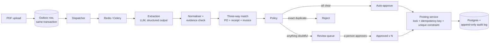
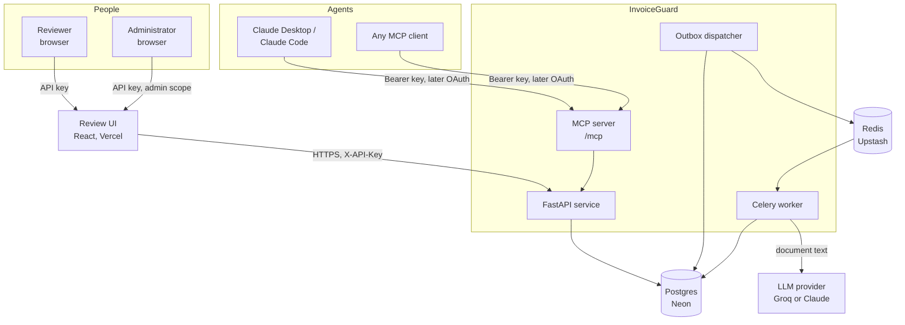
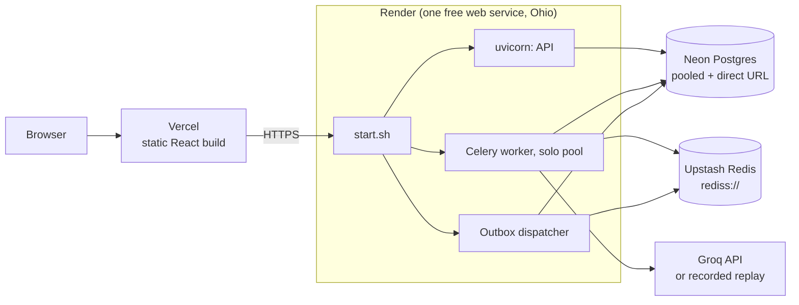
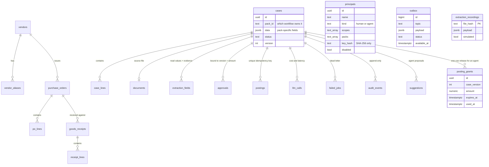
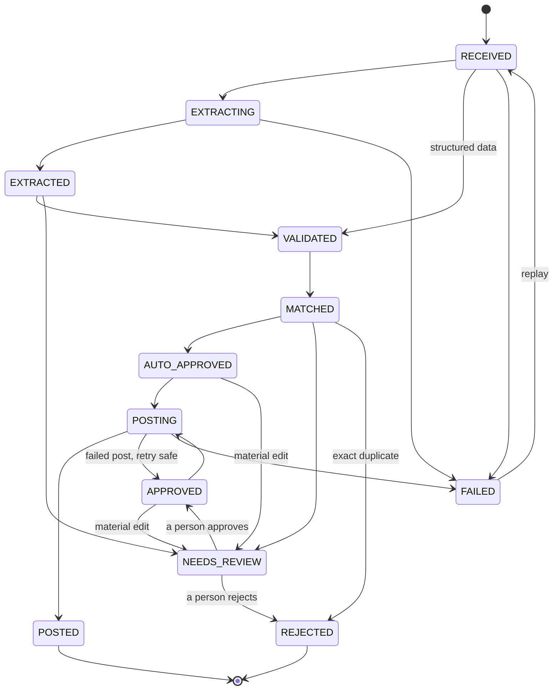
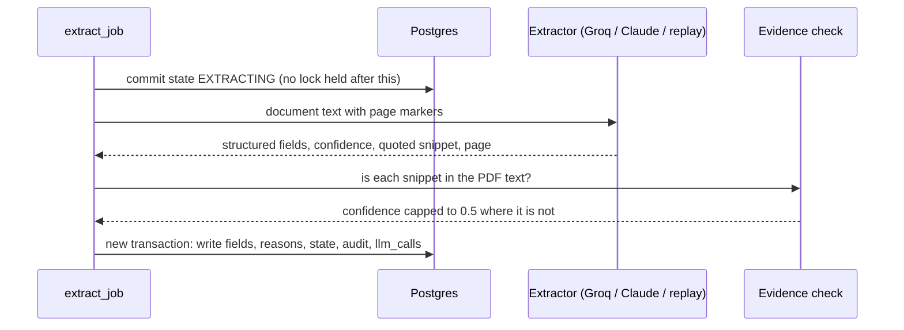
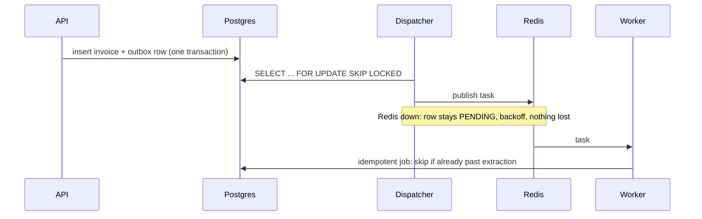
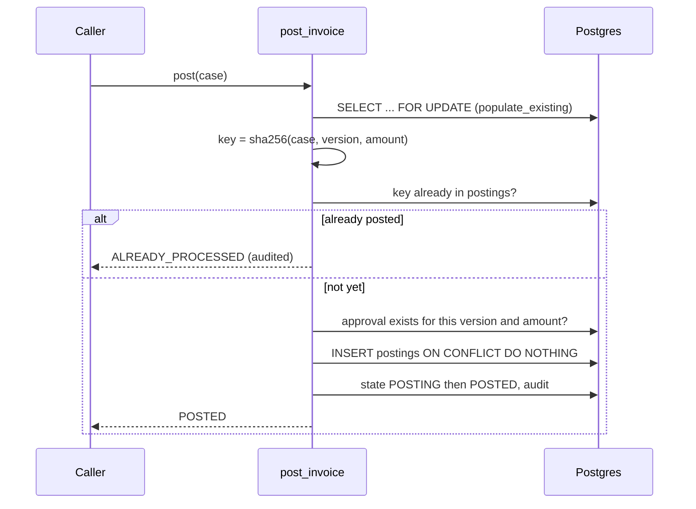
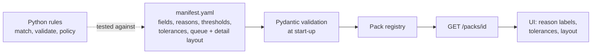

# InvoiceGuard

An approval-gated agent platform for **document-to-decision workflows**. It reads a business
document, checks it against the system of record with plain tested code, sends anything
doubtful to a person, and keeps an append-only audit trail that can reconstruct every
decision.

The first workflow (a *pack*) is **accounts payable**: supplier invoices reconciled against
purchase orders **and** goods receipts (three-way matching). The platform around it is built
so other workflows can be added as packs, and so that outside agents (Claude Desktop, Claude
Code, any MCP client) can read, submit and *suggest*, but never approve.

The model only reads the document. Arithmetic, matching, policy and posting are ordinary,
tested code, and nothing reaches the system of record without a valid, version-bound
approval from a person.

> All data is synthetic. No accuracy figure is published until a reproducible run against a
> real model produces it (see [Evaluation](#evaluation)).

## Status

| Area | State |
| --- | --- |
| Release 1: invoice workflow, outbox, dead-letter replay, concurrency-safe posting, evidence-backed extraction, evaluation harness, review UI, deployment | Built, deployed |
| Review UI redesign (dark/light, two-pane desk, card-based case page, toasts, keyboard flow) | Built |
| Pack layer: manifest schema, invoice manifest, `GET /packs`, UI reads reasons and tolerances from it | Built |
| Auth: scoped principals, hashed agent keys, bearer tokens, admin API, Connections page | Built |
| Core made case-based (`invoices` table became `cases` with a `pack_id`) | Built |
| Remote MCP server at `/mcp`: scoped tools, agent suggestions, per-case posting grants | Built |
| Second pack: expense reports | Next |
| OAuth sign-in for MCP clients | Planned |
| Credit notes, multi-currency, near-duplicates, calibration, tracing export, worker scaling | Planned |

Details and ordering are in [Release 2](#release-2).

## Contents

1. [How a document becomes a decision](#how-a-document-becomes-a-decision)
2. [High-level design](#high-level-design)
3. [Low-level design](#low-level-design)
4. [Security model](#security-model)
5. [Run it](#run-it)
6. [Evaluation](#evaluation)
7. [Deploy](#deploy)
8. [Release 2](#release-2)
9. [Repository layout](#repository-layout)
10. [Known limitations](#known-limitations)

## How a document becomes a decision



The decision uses three separate signals, never one blended score:

| Signal | Question |
| --- | --- |
| Extraction confidence | Was the document read correctly? (capped if the quoted evidence is not in the PDF) |
| Match quality | Do the invoice, PO line and receipt describe the same transaction? |
| Policy eligibility | Is this allowed to proceed (tolerances, receipts, duplicates, value limit)? |

A hard policy violation always blocks auto-approval, even at perfect confidence.

## High-level design

### System context

Who talks to the system, and through which door.



Design stance, in one line each:

- **A person decides.** Agents get `read`, `submit`, `propose` and (with a per-case grant)
  `post`. They can never hold `review` or `admin`; the API refuses it at key creation and
  again at every request.
- **The model reads, code decides.** The model's output is data to be checked, never an
  instruction. Its confidence is capped when its quoted evidence is not in the PDF.
- **One writer to the system of record.** Only the posting service writes, and only with a
  valid approval bound to the current version and amount.
- **Everything is reconstructible.** An append-only audit log (enforced by a database
  trigger) records what was seen, decided and by whom.

### Components

| Component | Responsibility | Does not |
| --- | --- | --- |
| Review UI | Queue, case page, decisions, metrics, agent connections | Hold business rules; it renders what the API and manifest say |
| API (FastAPI) | Authentication, scopes, rate limits, validation, HTTP surface | Call the model or run long work |
| Auth | Resolve a key to a principal with scopes | Let an agent approve, reject or administer |
| Packs | Declare a workflow: fields, reasons, thresholds, layout (manifest) plus its rules (Python) | Contain a rules language |
| Extraction | Read fields and quote the text each came from | Compute, match, decide or write |
| Normaliser + evidence check | Turn strings into typed values; verify each quote is in the PDF | Guess an ambiguous value |
| Matching, validation, policy, decision | Three-way match, arithmetic, duplicates, thresholds | Depend on the model |
| Workflow | States, transitions, approvals, versions | Write to the system of record |
| Posting service | The only writer to the system of record | Post without a valid approval |
| Outbox + dispatcher + worker | Reliable background work, retries, dead-letter | Lose a job when Redis is down |
| MCP server | Let agents read, submit and propose through the same rules | Approve or post on its own |

### Deployment



The hosted demo runs on free tiers. Because a free web service sleeps when idle, uploads made
meanwhile wait in the Postgres outbox and are processed when it wakes. The hosted demo
replays recorded extractions, so it needs no model key. See [docs/deploy.md](docs/deploy.md).

### Technology choices

| Choice | Why |
| --- | --- |
| Postgres for state, queue source of truth and audit | One transactional store makes the outbox, row locks and append-only trigger possible |
| Transactional outbox, not "publish after commit" | A job is never lost if Redis is down; delivery is at-least-once and the job is idempotent |
| Celery + Redis | Standard, observable, retry-capable workers |
| Decimal money, never floats | Matching tolerances and posting keys must be exact |
| Python packs + declarative manifest | Rules stay reviewable code; what a reviewer sees stays configuration |
| Record and replay of model responses | CI, evaluation and the demo are reproducible and free |

## Low-level design

### Data model



Invariants the database itself enforces:

| Invariant | Mechanism |
| --- | --- |
| Audit events are never changed or removed | Trigger rejects `UPDATE`, `DELETE`, `TRUNCATE` on `audit_events` |
| A posting happens once per (case, version, amount) | Unique constraint on `postings.idempotency_key` |
| A grant is spent at most once | One atomic `UPDATE ... WHERE used_at IS NULL AND not expired AND version and amount match` |
| Agent keys are not recoverable from a leak | Only `key_hash` (SHA-256) is stored; the key is shown once |
| Schema equals models | A test applies every migration and fails on any drift from the models |

### Invoice state machine



Transitions are validated in `workflow/state_machine.py`; anything else raises
`IllegalTransition`. A material edit increments the version, which voids every earlier
approval.

### Decision logic

```text
decide(signals, thresholds):
    if exact_duplicate                      -> REJECT          [DUPLICATE_EXACT]
    reasons = policy.hard_violations        # validation + match + duplicate-by-number + value limit
    if extraction_confidence < 0.90         -> reasons += LOW_EXTRACTION_CONFIDENCE
    if match_quality < 1.0                  -> reasons += LOW_MATCH_QUALITY
    if reasons                              -> NEEDS_REVIEW    (reasons, hard ones first)
    else                                    -> AUTO_APPROVE
```

Thresholds and tolerances live in the pack manifest
(`backend/src/invoiceguard/packs/invoices/manifest.yaml`), and a test fails if the manifest
and the code that uses them ever disagree.

### Extraction pipeline



The model call happens outside every transaction, so a slow model never holds a row lock.
Failures are classified: rate limits, network and 5xx errors retry with backoff; refusals,
malformed output and rejected requests are permanent. Both end in the dead-letter table with
an operator replay.

### Reliable background work (outbox)



### Posting (the only writer)



Three layers protect it: the row lock serialises attempts, the idempotency key turns repeats
into a no-op, and the unique constraint is the last line of defence. Tests post the same
invoice from two to six workers at once and show exactly one posting, with the lock on and
with it switched off.

### Authentication and authorisation

Two kinds of key become a `Principal` (`api/auth.py`):

| Key | Source | Who | Scopes |
| --- | --- | --- | --- |
| Reviewer key | `API_KEYS` env (`key:name`) | A person using the UI | `read submit review post`, plus `admin` if the name is in `ADMIN_USERS` |
| Issued key (`ig_...`) | `POST /principals`, stored as SHA-256 | An agent or integration | Chosen at creation, from `read submit propose post` only |

| Scope | Allows |
| --- | --- |
| `read` | See cases, documents, metrics, packs |
| `submit` | Upload a document or submit data |
| `propose` | Record a suggested decision (changes no state) |
| `review` | Approve, reject, edit, replay |
| `post` | Post an approved case (an agent additionally needs a per-case grant) |
| `admin` | Issue and disable keys |

Keys are accepted as `X-API-Key` or `Authorization: Bearer`. The actor recorded in the audit
log comes from the key, never the request body. Disabling a principal takes effect on the
next request.

### API surface

| Route | Scope | Purpose |
| --- | --- | --- |
| `GET /health` | none | Postgres and Redis checks |
| `GET /me` | any key | Name, kind, scopes, packs |
| `GET /packs`, `GET /packs/{id}` | `read` | Installed packs and their manifests |
| `POST /invoices` | `submit` | Submit structured data |
| `POST /documents` | `submit` | Upload a PDF |
| `GET /invoices`, `GET /invoices/{id}` | `read` | Queue and detail |
| `GET /invoices/{id}/document`, `/extraction` | `read` | Source file; values with evidence |
| `POST /invoices/{id}/approve`, `/reject`, `/edit` | `review` | Decisions, bound to `expected_version` |
| `POST /invoices/{id}/replay` | `review` | Re-run extraction for a failed case |
| `POST /invoices/{id}/post` | `post` | Post an approved case |
| `GET /failed-jobs`, `GET /metrics/summary` | `read` | Operations and metrics |
| `GET/POST /invoices/{id}/suggestions` | `read` / `propose` | Agent suggestions on a case |
| `POST /invoices/{id}/suggestions/{sid}/dismiss` | `review` | A person dismisses a suggestion |
| `GET/POST /invoices/{id}/grants` | `read` / `review` | List grants; a person releases an approved case for an agent to post |
| `GET/POST /principals`, `POST /principals/{id}/disable` | `admin` | Manage keys |
| `POST /mcp` (streamable HTTP) | bearer key | The MCP server, see below |

An agent key cannot call `POST /invoices/{id}/post` at all: agents post through the MCP
`post_case` tool, with a grant.

Writes are rate limited per key (fixed window in Redis, fails open if Redis is down) and can
be paused for the whole deployment with `WRITES_ENABLED=false`.

### MCP server and posting grants

The MCP server is mounted inside the API at `/mcp` (streamable HTTP, stateless, so it runs on
the same free web service). Every request carries a bearer token. `ApiKeyVerifier` resolves it
to the same `Principal` the REST API uses; an OAuth verifier will replace it behind the same
interface. The tools call the same services as the UI.

| Tool | Scope | Changes state? |
| --- | --- | --- |
| `list_packs_available`, `describe_pack`, `list_cases`, `get_case`, `get_audit`, `lookup` | `read` | No (database-enforced read-only transaction) |
| `submit_document` | `submit` | Creates a case and queues extraction |
| `propose_decision` | `propose` | Stores a suggestion only |
| `post_case` | `post` | Posts, but only with a valid grant |

There is no approve, reject or edit tool, and a test fails if one is ever added.

```mermaid
sequenceDiagram
    participant A as Agent (MCP)
    participant P as Person (UI)
    participant S as Service
    P->>S: approve (version 3, amount 906.14)
    P->>S: release for posting, valid 15 minutes
    S-->>P: grant (case, version 3, amount, expiry)
    P-->>A: grant id
    A->>S: post_case(case, grant)
    S->>S: lock row; spend grant atomically; post once
    S-->>A: POSTED
```

A grant is bound to the version and amount it was issued for, expires within 5 to 60
minutes, and is spent by its first use (atomic `UPDATE ... WHERE used_at IS NULL`). Editing
the case afterwards voids it. If posting fails, the transaction rolls back and the grant is
not spent. Every tool call and every grant event is audited under `mcp:<agent>`. See
[docs/mcp.md](docs/mcp.md).

### Packs (how a workflow is described)



A manifest carries no logic. Rules stay as Python so a change to them is reviewed like any
code change. Tests assert every reason code the rules can emit is described in the manifest
and that the manifest's numbers equal the ones the code uses.

### Configuration

| Variable | Meaning |
| --- | --- |
| `DATABASE_URL` | App traffic (Neon: pooled URL) |
| `DATABASE_URL_UNPOOLED` | Migrations (Neon: direct URL) |
| `REDIS_URL` | `redis://` or `rediss://` (validated, secrets never echoed) |
| `API_KEYS` | `key:name` pairs for reviewers |
| `ADMIN_USERS` | Reviewer names that may manage keys |
| `EXTRACTION_PROVIDER`, `EXTRACTION_MODEL`, `EXTRACTION_MODE` | `groq`/`anthropic`; model; `live` or `replay` |
| `GROQ_API_KEY`, `ANTHROPIC_API_KEY` | Provider keys, only for live extraction |
| `CORS_ORIGINS` | Browser origins allowed to call the API |
| `RATE_LIMIT_WRITES_PER_MINUTE`, `RATE_LIMIT_UPLOADS_PER_MINUTE`, `WRITES_ENABLED` | Public-demo safety |

### Failure modes

| Failure | Behaviour |
| --- | --- |
| Redis down | Uploads still succeed; jobs wait in the outbox; limits fail open; health shows `degraded` |
| Model rate-limited or unreachable | Retried with backoff, then dead-lettered with replay |
| Model returns garbage or is prompt-injected | Normaliser refuses ambiguous values; evidence check caps confidence; arithmetic and policy still run |
| Two workers post the same case | One posting; the other gets `ALREADY_PROCESSED`; both audited |
| Duplicate task delivery | The extraction job finds the case already past extraction and stops |
| Stale browser tab approves an old version | `expected_version` mismatch returns 409 |
| Agent key leaked | Disable the principal; its next request is refused |
| Agent and a person act on the same case | Distinct actors in the audit log (`mcp:<agent>` versus the reviewer's name) |
| Two agents use one grant at once | One posts; the rest are refused; exactly one posting row |

## Security model

| Threat | Control |
| --- | --- |
| An agent approves or pays something | Agent keys cannot hold `review` or `admin`; no approve tool exists; posting needs a person's one-use grant |
| An agent posts something a person did not release | The grant is bound to case, version and amount; edits void it |
| A document instructs the model to approve | The model never decides; evidence check, arithmetic and policy are code |
| Key theft from a database leak | Only SHA-256 hashes stored; keys shown once |
| Key leaked in logs or errors | Connection strings and secrets are hidden from validation errors |
| Tampering with history | Append-only audit log enforced by a database trigger |
| Reviewer acts under another name | The actor comes from the key, not from the request |
| Abuse of the public demo | Per-key rate limits, upload size cap, write kill switch |

## Run it

Requires Docker with Compose and Node 20+.

```bash
docker compose up --build -d
docker compose exec api python -m invoiceguard.generator.demo_data --count 16 --submit
cd web && npm install && npm run dev
```

Open http://localhost:5173 and sign in with the local development key `dev-key` (the
`dev-key:dev-reviewer` pair also works). The local stack makes `dev-reviewer` an
administrator, so the **Connections** tab can issue agent keys. The demo runs in replay mode
with simulated extractions, so it needs no model key. To extract with a real model set
`EXTRACTION_MODE=live` and `GROQ_API_KEY` (default `openai/gpt-oss-20b`), or
`EXTRACTION_PROVIDER=anthropic` with a Claude model and `ANTHROPIC_API_KEY`.

Health check: `curl http://localhost:8000/health`

Run the tests (they build a throwaway Postgres database from the real migrations, so Compose
must be running):

```bash
cd backend && pip install -e ".[dev]" && ruff check src tests && pytest
```

Keyboard on the review desk: `/` search, `j` / `k` move, `Enter` open.

## Evaluation

```bash
cd backend
python -m invoiceguard.evaluation.runner --extractor oracle --gate
python -m invoiceguard.evaluation.runner --extractor noisy --gate
```

Oracle and noisy runs test the controls with simulated extraction; they are not model
accuracy results. Real-model numbers come from a `live` run, which records responses so
`replay` can re-score them in CI. The locked set has 216 cases split by vendor layout, with
one layout held out; metrics state their denominators, and two gates fail on any wrongly
auto-approved invoice or any clean invoice approved with a misread field. Details:
[eval/README.md](eval/README.md).

## Deploy

Free tiers throughout: Vercel (UI), Render (API, worker and dispatcher in one service), Neon
(Postgres), Upstash (Redis). Step by step, including the Neon pooled/direct URL split and the
variables to set: [docs/deploy.md](docs/deploy.md). Operations: [docs/runbook.md](docs/runbook.md).

## Release 2

The aim: reuse the same approval-gated core for any document-to-decision workflow, and let
outside agents work through it safely.

| Step | What | State |
| --- | --- | --- |
| Pack layer | Manifest schema, `/packs`, UI driven by the manifest | Built |
| Auth | Scoped principals, hashed agent keys, bearer tokens, admin API, Connections page | Built |
| Core made case-based | `invoices` became `cases` with `pack_id` and `data`; HTTP routes under `/invoices` unchanged | Built |
| Remote MCP server | Streamable HTTP at `/mcp`; list, read, submit, propose; posting only with a short-lived per-case grant a person issues | Built |
| Expense-report pack | Receipt vs card transaction vs policy; same core, no pack-specific branches | Next |
| OAuth for MCP clients | Resource-server only; the API-key verifier is the interim | Planned |
| Credit notes, multi-currency | Netting, returns, rate date and tolerance | Planned |
| Near-duplicate detection | Normalised amount, date, PO and lines as a review signal | Planned |
| Calibration, tracing export, worker scaling | Reliability tables; OpenTelemetry; split worker | Planned |
| Scanned documents | OCR behind the extractor interface (stretch) | Planned |

## Repository layout

| Path | Contents |
| --- | --- |
| `backend/src/invoiceguard/packs` | Pack manifest schema, registry, the invoice pack |
| `backend/src/invoiceguard/domain` | Matching, validation, duplicates, policy, decision (no I/O) |
| `backend/src/invoiceguard/workflow` | State machine, approvals, posting service, audit log |
| `backend/src/invoiceguard/extraction` | Model clients, normaliser, evidence check, cost metrics |
| `backend/src/invoiceguard/jobs` | Outbox, dispatcher, extraction job, dead letter and replay |
| `backend/src/invoiceguard/api` | Routes, auth and scopes, rate limits |
| `backend/src/invoiceguard/mcp_server` | Remote and stdio MCP server, token verifier, tools |
| `backend/src/invoiceguard/evaluation` | Locked set, simulated errors, runner and gates |
| `backend/alembic` | Migrations |
| `web/` | React review UI |
| `eval/` | Locked test set, gates, reports, model recordings |
| `docs/` | Architecture, deployment, runbook, case study |

## Documents

- [Connecting an agent (MCP)](docs/mcp.md)
- [Architecture and trade-offs](docs/architecture.md)
- [Deployment](docs/deploy.md)
- [Runbook](docs/runbook.md)
- [Case study: what broke and what changed](docs/case-study.md)
- [Discovery brief](docs/discovery-brief.md)
- [Platform feedback](docs/platform-feedback.md)

## Known limitations

- Synthetic data only, and a Postgres database stands in for the ERP. No claim of
  ERP-grade compliance or production readiness.
- Clean PDFs only; no scanned or handwritten invoices yet.
- Reviewer identity is a static API key and agent keys are issued keys; there is no SSO or
  OAuth yet. MCP clients that only support browser sign-in cannot connect.
- Only the invoices pack is exposed. The data model and manifest are pack-ready; the second
  pack (expense reports) is not built.
- No posting reversal; a wrong posting is handled outside the system (see the runbook).
- The model's confidence is self-reported and uncalibrated; the evidence check is the
  independent control.
- The hosted demo replays recorded extractions; a real-model accuracy result needs a live
  run with a provider key.
