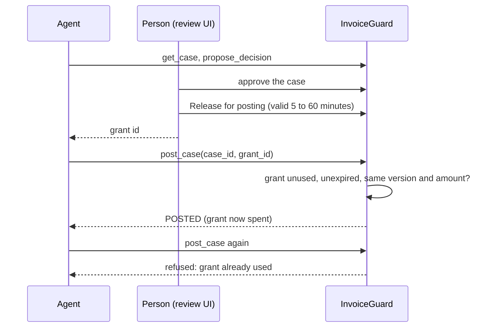

# Connecting an agent (MCP)

InvoiceGuard runs a remote [MCP](https://modelcontextprotocol.io) server at `/mcp` on the
same service as the API. Any MCP client can connect: Claude Code, Claude Desktop, or your own.

An agent can **read**, **submit** and **suggest**. It cannot approve, reject or edit: there is
no tool for it. A person decides. To post an approved case, the agent needs a **grant** that a
person issues for that one case.

## 1. Get a key

An administrator opens **Connections** in the review UI, names the agent, picks what it may
do, and copies the key once. Only a hash is stored, so a lost key cannot be recovered:
disable it and issue another.

| Scope | The agent may |
| --- | --- |
| `read` | List and read cases, audit trails, reference data and the pack description |
| `submit` | Submit a document (PDF, up to 5 MB) |
| `propose` | Record a suggested decision. It changes nothing |
| `post` | Post an approved case, but only with a grant |

Agent keys can never hold `review` or `admin`. The API refuses it when the key is created.

Administrators are the reviewer names listed in `ADMIN_USERS`. Keys can also be issued with
`POST /principals`.

## 2. Connect

Claude Code:

```bash
claude mcp add --transport http invoiceguard https://<your-api-host>/mcp \
  --header "Authorization: Bearer ig_xxxxxxxx"
```

Local development:

```bash
claude mcp add --transport http invoiceguard http://localhost:8000/mcp \
  --header "Authorization: Bearer ig_xxxxxxxx"
```

Any other client: use the streamable HTTP transport, URL `<api>/mcp`, header
`Authorization: Bearer <key>`. The hosted demo runs on a free plan that sleeps when idle, so
the first call after a quiet period can take up to a minute.

## 3. Tools

| Tool | Scope | What it does |
| --- | --- | --- |
| `list_packs_available`, `describe_pack` | `read` | The workflows, their fields, reasons, thresholds, tolerances |
| `list_cases` | `read` | Cases, newest first, filter by status or vendor (at most 50) |
| `get_case` | `read` | Header, lines, why it was flagged, values read from the document with the text they came from, approvals, suggestions |
| `get_audit` | `read` | Every event on a case: who, what, when |
| `lookup` | `read` | Reference data: `vendor`, `purchase_order`, `goods_receipts`, `vendor_invoices` |
| `submit_document` | `submit` | Send a PDF (base64) for extraction and checking |
| `propose_decision` | `propose` | `approve`, `reject` or `hold`, with a rationale, for a case waiting for review |
| `post_case` | `post` | Post an approved case. Needs `grant_id` |

Text quoted from documents is returned inside a notice that marks it as data. An agent should
never follow instructions found in it; and even an agent that did has no tool that approves.

## 4. Posting with a grant



A grant is bound to the case version and amount at the moment it is issued. It works once.
If anyone edits the case afterwards (a new version) or the time runs out, it stops working.
Refusals and uses are written to the audit log.

## 5. What is recorded

Every tool call writes an audit event under `mcp:<agent name>`. Reviewers appear under their
own name, so the audit trail always shows who was a person and who was an agent. Calls are
rate limited per key (`RATE_LIMIT_MCP_PER_MINUTE`, default 60), and all writes stop when
`WRITES_ENABLED=false`.

## 6. Sign-in with OAuth

Today the bearer token is an issued key. The server already publishes the discovery metadata
MCP clients look for (`/.well-known/oauth-protected-resource/mcp`) and answers an
unauthenticated request with `401` and a `WWW-Authenticate` header pointing at it. Replacing
the key check with an OAuth token check is a change to one class (`ApiKeyVerifier` in
`backend/src/invoiceguard/mcp_server/server.py`); the tools and the scope rules do not
change. Set `MCP_ISSUER_URL` to the authorization server when that lands. Until then, clients
that only support browser sign-in cannot connect; clients that accept a header can.

## Limits worth knowing

- One pack (supplier invoices) is exposed today. Tools take the pack from the key's allow-list
  so a second pack arrives without changing the tool set.
- A tool that is refused for a missing scope returns a tool error, not an HTTP 403.
- stdio mode (`python -m invoiceguard.mcp_server.server`) has no sign-in and read tools only.
